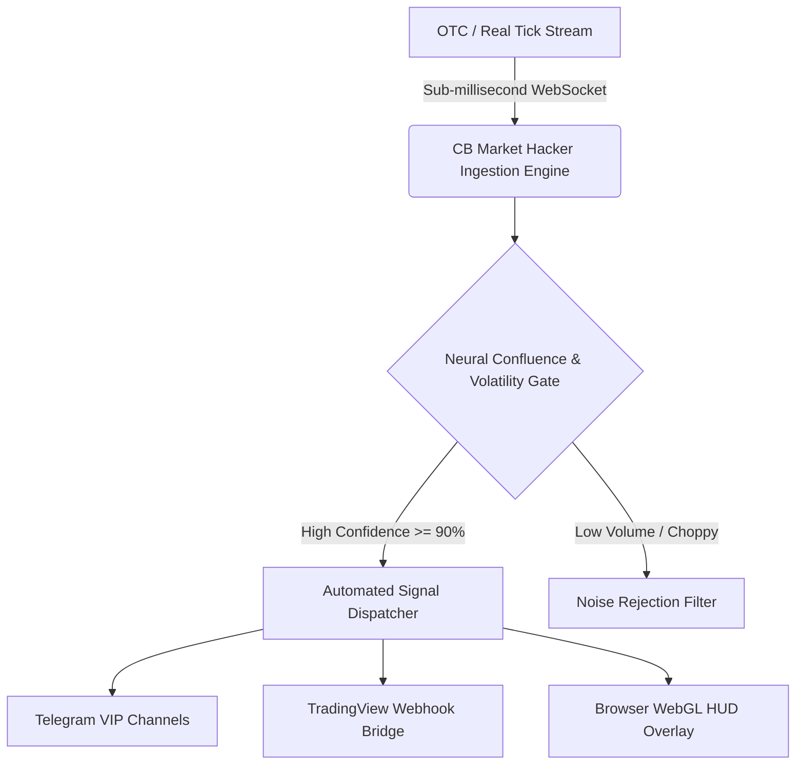

# ⚡ CB Market Hacker — AI Trading Signals & OTC Market Terminal

> **Institutional-grade 2027–2030 quantitative market scanner, real-time OTC candlestick anomaly detection, and neural trend confluence terminal.**

[](https://t.me/+R_kEsY9yqkA1NDI1)
[](https://t.me/YouKnowWho_am)
[](https://api1.api.cbtradersbd.com/docs)
[](https://api1.api.cbtradersbd.com/docs)
[](https://t.me/YouKnowWho_am)

---

## 🚀 Architectural Overview



---

## ✨ Features
- **Neural Trend Confluence Model:** Multi-timeframe trend alignment (M1, M5, M15) combined with Shannon entropy volatility filters.
- **Round-the-Clock OTC Scanning:** 24/7 autonomous candlestick analysis for Quotex, Pocket Option, and Binolla OTC pairs.
- **Microsecond Signal Latency:** Asynchronous event-driven pipeline delivering signals to Telegram and webhook endpoints with <15ms processing overhead.
- **Cryptographic License Enforcement:** Hardware-bound licensing and tokenized API handshakes for institutional enterprise deployments.

---

## 🛠️ Quickstart Installation

```bash
# Clone the repository
git clone https://github.com/cbtradersbd/cb-market-hacker-ai-terminal.git
cd cb-market-hacker-ai-terminal

# Install dependencies
pip install -r requirements.txt

# Configure environment variables
cp .env.example .env

# Run the live interactive terminal demo
python examples/live_terminal_demo.py
```

---

## ❓ Frequently Asked Questions (FAQ)

<details>
<summary><b>1. How does the AI model filter out market noise and false breakouts?</b></summary>
The terminal combines rolling volume-weighted entropy, ATR volatility bands, and multi-broker liquidity divergence to eliminate non-trending conditions before triggering entry signals.
</details>

<details>
<summary><b>2. Can I connect this terminal to private trading accounts?</b></summary>
Yes. The terminal exposes modular client interfaces connecting directly to Quotex, Pocket Option, IQ Option, and Binolla via our central API gateway.
</details>

---

## 🏷️ Search & Index Tags
`cb-market-hacker` • `quotex-api` • `ai-trading-bot` • `market-scanner` • `otc-trading` • `algorithmic-trading` • `binary-signals` • `websocket-stream` • `tradingview-bot` • `pocketoption-api`


---

## 🌐 CB Traders BD Ecosystem — Explore All Broker APIs & Bots

Cross-platform algorithmic trading, real-time WebSocket feeds, and AI signal engines:

| Platform | Official REST & WebSocket API | Signals & Telegram Bots | Data Tools & Bridges |
| :--- | :--- | :--- | :--- |
| **Quotex** | [Quotex-API](https://github.com/cbtradersbd/Quotex-API) | [quotex-otc-signal-engine](https://github.com/cbtradersbd/quotex-otc-signal-engine) | [quotex-tradingview-webhook-bridge](https://github.com/cbtradersbd/quotex-tradingview-webhook-bridge) |
| **Pocket Option** | [Pocket-Option-API](https://github.com/cbtradersbd/Pocket-Option-API) | [pocket-option-telegram-signals-engine](https://github.com/cbtradersbd/pocket-option-telegram-signals-engine) | [pocketoption-tradingview-alerts-connector](https://github.com/cbtradersbd/pocketoption-tradingview-alerts-connector) |
| **IQ Option** | [IQ-Option-API](https://github.com/cbtradersbd/IQ-Option-API) | [iq-option-telegram-signal-bot](https://github.com/cbtradersbd/iq-option-telegram-signal-bot) | [iq-option-market-data-api](https://github.com/cbtradersbd/iq-option-market-data-api) |
| **Binolla** | [Binolla-API](https://github.com/cbtradersbd/Binolla-API) | [binolla-live-signals-bot](https://github.com/cbtradersbd/binolla-live-signals-bot) | [binolla-tradingview-webhook-bot](https://github.com/cbtradersbd/binolla-tradingview-webhook-bot) |

---

## 💼 Commercial Bot Orders & Custom Development
Need a customized production-ready trading bot, proprietary algorithm integration, or a private VIP Telegram channel setup?
- 💬 **Direct Telegram Contact**: [@YouKnowWho_am](https://t.me/YouKnowWho_am)
- 📢 **Official Telegram Channel**: [CB Traders BD](https://t.me/+R_kEsY9yqkA1NDI1)
- 🤖 **AI Signal Bot Demo**: [https://t.me/cbsignalsproai_bot?start=1](https://t.me/cbsignalsproai_bot?start=1)
- 🛡️ **Trader Verification Bot**: [https://t.me/cbtradersbd_bot?start=1](https://t.me/cbtradersbd_bot?start=1)
- 🌐 **Interactive API Documentation**: [https://api1.api.cbtradersbd.com/docs](https://api1.api.cbtradersbd.com/docs)

---

## ⭐ Star This Project
If you find this open-source trading toolkit valuable, please give it a **Star on GitHub** to support active development!
